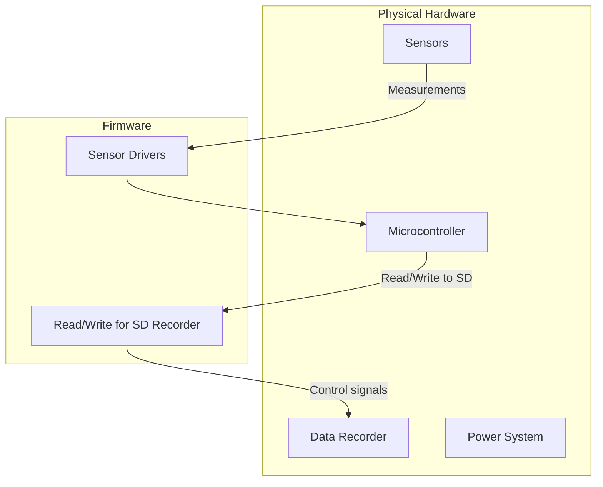

# Basic-Weather-Balloon-BlackBox
My species is mainly a ground dwelling creature, however, we noticed that the sky does have an effect on our subterranian lifestyle. Therefore, it is always a good idea to check the weather. This is a guide to build a weather balloon with mission critical sensors for weather service data collection.

## Overview of System Operations



## Project Structure Tree
```
BlackBok-for-Weather-Balloons/
├── docs/
│ ├── pdf/
| |  ├── Concept of Operations.pdf
| |  ├── Template for Assembly Master Schedule.pdf
| |  └── Template for PreLaunch Checklist.pdf
│ ├── hardware/
| |  ├── architecture.md
| |  ├── wiring.md
| |  └── serial-protocol.md
│ └── requirements.md
├── firmware/
│ ├── data_recorder.ino
│ └── error_testing.ino
├── README.md
└── LICENSE
```
